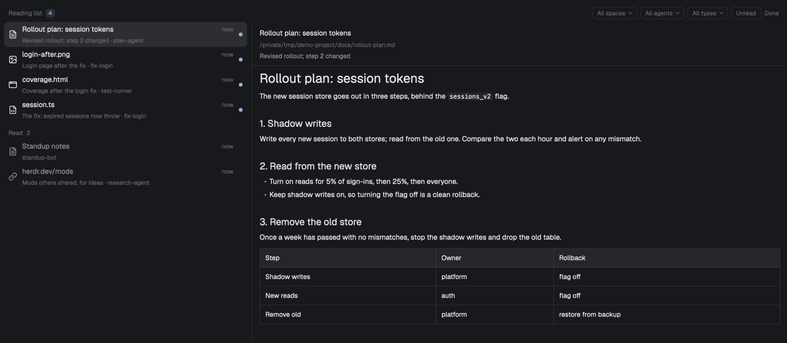

# herdr-reading-list

A reading list for [Herdr](https://herdr.dev). Your agents and tools put files (markdown they
wrote, screenshots, HTML reports, PDFs, folders) or URLs on the list with one command, `rl add`,
and a note saying why. The list shows who added each item, previews it in place, and opens it in its
default app when you press Enter.



## Platforms

| | Open (Enter) | Show in the file manager (`o`) | Space: preview window | Thumbnails in the pane | Popup key |
|---|---|---|---|---|---|
| macOS | `open` | Finder (`open -R`) | Quick Look | Quick Look (HTML, PDF, ...) | `cmd-shift-i` |
| Linux | `xdg-open` | the file manager over D-Bus (`gdbus`), else `xdg-open` on its folder | GNOME Sushi, if installed; else the preview in the pane | images only; other types show their icon | `ctrl-shift-i` |
| Windows | coming | | | | |

macOS has everything. Linux is supported: opening needs `xdg-open` (xdg-utils), showing in the file
manager works with any file manager that answers the freedesktop `FileManager1` call (Nautilus,
Dolphin, Nemo, Caja, Thunar...), and the Space preview window needs GNOME Sushi (the `sushi`
package). Without Sushi, Space shows or hides the preview in the pane instead and says so once;
when a program is missing, the list says which one instead of failing quietly. Markdown, text, code,
images and folders preview in the pane on both. Items on other machines are listed from macOS and
Linux alike.

Each of these actions is a handler: a small program the list runs with the item. The table is what
the built-in handlers do (`mods/readlist/handlers/macos.sh` and `linux.sh`); you can put your own
in front of them, see [Your own handler](#your-own-handler).

## Install

Ask your Herdr agent:

> add herdr.dev/mods/pbleisch/herdr-reading-list

It reads [RECIPE.md](RECIPE.md) and the files, copies `mods/readlist` into your Herdr home
(`~/.config/herdr-app/mods/readlist`), merges `keys.json` into yours where the key is free, and
checks the mod. To do it by hand, copy the `mods/readlist` folder there yourself, add the key in
`keys.json` for your platform to your own `keys.json` (`cmd-shift-i` on macOS, `ctrl-shift-i` on
Linux), and run `herdr-app check ~/.config/herdr-app/mods/readlist`.

What the mod does on your computer: it runs programs (`sh` scripts, its own `rl`, and on macOS
`open` and `qlmanage` for Quick Look and thumbnails, on Linux `xdg-open` and `gdbus` for the file
manager and GNOME Sushi, and only if you turn it on, your own handler), reads the files on the list
wherever they are (and, only if
you turn on "Files Claude Code sends", Claude Code's session files and transcripts), and writes only
its list folder, its own `.cache/` and, when you press Install rl, `~/.local/bin/rl`. On other
machines Herdr reaches, it reads their list folder and the files on it through Herdr every 15 s,
copies a file into its `.cache/` when you open or preview it, removes an item file on Shift-D, and
writes `~/.local/bin/rl` there only when you press Install rl on that machine. It uses no network
of its own beyond Herdr's connections, and `scp` for a file over 5 MiB that `hc exec` could not
fetch (a URL item opens in your browser).

Then open it:

- `cmd-shift-i` (`ctrl-shift-i` on Linux) opens the list as a popup over the window
  (`mod.open:readlist`);
- `herdr-app do pane.split '{"direction":"right","mod":"readlist"}'` opens it as a pane;
- or add a block with `{"mod": "readlist", "props": {"role": "sidebar"}}` to your layout, for
  example under the agents list in the left sidebar.

### Install rl

`rl` is the command agents use to add items. It ships inside the mod (`mods/readlist/bin/rl`, POSIX
`sh`, no dependencies). While it is not on your PATH, the list shows a banner with an **Install rl**
button (also `herdr-app do readlist.install-rl`): it copies `rl` to `~/.local/bin/rl`, tells you if
`~/.local/bin` is not on your PATH, and never replaces a different program called `rl`. "Not now"
hides the banner. The same banner offers **Install rl on devbox** for another machine whose list
it reads and that has no `rl`, so agents there can add to the list; it installs to
`~/.local/bin/rl` on that machine.

Agents without `rl` can still add items by writing a small JSON file; see
[skill/reading-list/SKILL.md](skill/reading-list/SKILL.md).

### Teach your agents

[skill/reading-list/SKILL.md](skill/reading-list/SKILL.md) is a standard agent skill (a folder with
a `SKILL.md` that has `name` and `description` frontmatter). It tells an agent:

- when to add: deliverables, reports, results and plans waiting for your call, and not routine
  progress, scratch files or every save;
- which kind to use: `review` (please read), `result` (what a task produced) or `fyi` (no toast);
- how to write a note that says what the item is and what the agent wants from you;
- `--from NAME` when it runs outside a Herdr terminal, and the no-install JSON fallback.

To install it, copy the `skill/reading-list` folder into your agent's skills folder, for example
`~/.claude/skills/reading-list` (Claude Code, every project) or `.claude/skills/reading-list` in
one project; other agents that read skills take the same folder in theirs. An agent without
skills can be given the file's text in its instructions instead.

### Files Claude Code sends

Claude Code agents can already send you a file with their SendUserFile tool. Turn on **Files
Claude Code sends** (in the `f` filter menu, under "Also add", or
`herdr-app do readlist.claude-files`) and every file a Claude Code agent on this computer sends from
then on also lands on the list, as a `result` from that agent with the send's caption as the note,
without the agent running `rl`. It is off until you turn it on; the same entry turns it off.

The list finds each Claude Code agent's session the way Claude Code records it
(`~/.claude/sessions/` and the session transcript under `~/.claude/projects/`, or
`$CLAUDE_CONFIG_DIR`) and reads only the transcript lines that record a delivered file. Each file
is added once: a file already on the list (added with `rl`, or sent before) stays as it is, and a
send stays handled after you delete its item. Transcripts are read while the list is shown in a
pane, the sidebar or the popup; sends of a session that ended while it was not shown are missed.
Agents on other machines are not read.

## Use

```sh
rl add docs/plan.md --note "Revised rollout plan; section 3 changed"   # prints the item id
rl add https://example.com/report --kind fyi     # fyi: no toast
rl ls                 # open items; --unread, --done, --all, --json
rl done docs/plan.md  # you have handled it
rl rm docs/plan.md    # take it off the list
rl add out/report.html --kind result --if-new   # only if it is not on the list yet
```

The list lives in `~/.local/state/reading-list/` (`$READING_LIST_DIR` overrides it): one JSON file
per item in `items/`, and your read and done state in `state.json`. Adding the same path again
replaces the item (new note, unread again, moved to the top). Inside a Herdr terminal, `rl` records
which agent added the item; elsewhere `--from NAME`, or your user name and the calling program.

Anything put in the list folder's `inbox/` (a screenshot tool's output folder, a browser
download) becomes an item from "inbox"; dropping files onto the list adds them too.

New items post a toast ("Reading list: plan.md", or "3 new on your reading list" for a burst); `fyi`
items and files you dropped do not. Clicking the toast focuses the list or opens the popup.

### Keys

In the list:

| Key | Does |
|---|---|
| click, `j` / `k`, arrows, `g` / `G` | select (selecting never opens anything) |
| Enter, double-click | open in its app; marks it read |
| Space | Quick Look panel on macOS, GNOME Sushi on Linux (again closes it) |
| `p` | show or hide the preview in the pane |
| `v` | a preview pane on the right of the window that follows the selection |
| `o` | show in Finder (the file manager on Linux) |
| `c` | copy the path or URL |
| `r` | read / unread |
| `d` | done (Tab shows the Done view, where `d` or `u` brings it back) |
| Shift-D | delete the item from the list (like `rl rm`; the file stays) |
| `/` | filter by title, note and path |
| `f` | filter menu: space, agent, type, unread only; also the "Files Claude Code sends" switch and Actions (built-in or your handler) |
| Shift-R | list this machine and every other one again now |

Each key is also a command (`herdr-app do readlist.open`, `readlist.down`, ...) you can bind in
`keys.json`. Global: `cmd-shift-i` (`ctrl-shift-i` on Linux) opens the popup.

In a pane 520 px or wider, the selected item's preview shows beside the list: markdown rendered,
text and code highlighted, images, a folder's entries, and on macOS a Quick Look thumbnail of HTML,
PDF and anything else Quick Look can draw (on Linux those show their type's icon). Narrower, `p`
shows it below the list. A read item whose file changed since shows a "changed" chip. Executable
items (apps, scripts, and on Linux `.desktop` files, AppImages and packages) are shown in the file
manager, never opened.

### Other machines

An agent on another machine Herdr reaches (one in `hc machine ls`) runs `rl add` there; the item
goes in that machine's own list folder, and the list here shows it with the machine's name. The
list reads each machine every 15 s (Shift-R reads them now). Markdown and text previews are read
on that machine; to open, Quick Look or show an image, the file is first fetched into the mod's
`.cache/`, and fetched again when it changes there. The row then says "copy from devbox, fetched
18:42"; edits to the copy stay on your computer. A file over 50 MiB is fetched only when you press Enter
twice. A machine that stops answering keeps its items, with an "offline" chip, until it answers
again. Windows machines have no list.

### Your own handler

Enter, Space, `o` and the pane's thumbnails each run a handler. You can write your own, a program
the list asks first, so a file opens the way you want on this computer; whatever it leaves alone
falls through to the built-in handler. It is off until you turn it on.

1. Write it at `~/.config/herdr-app/readlist/handler` (outside the mod's folder, so reinstalling the
   mod keeps it), in any language, executable (`chmod 755`), owned by you, and not writable by
   anyone else.
2. Turn it on: `f`, then Actions, then **Your handler** (or `herdr-app do readlist.handler`). The
   list checks it and says so; from then on the key hints end with "your handler".
3. After you edit it, the list stops running it and shows a banner with its path; **Use it** turns
   the new version on. **Turn off**, or Actions, then **Built-in**, goes back to the built-in
   handler.

The list runs it with separate arguments, never through a shell string; the item is always the
last argument, right after `--`:

| Arguments | When | What it does |
|---|---|---|
| `open -- PATH` | Enter | open the file or folder |
| `reveal -- PATH` | `o`, and Enter on a file that could run | show it in the file manager |
| `open-url -- URL` | Enter on a link (http and https only) | open the link |
| `preview -- PATH` | Space | show a preview window; may print one word (a token, such as a pid) on stdout |
| `preview-close TOKEN same\|other -- PATH` | Space while its preview is open | `same`: Space again on that item, close it (exit 0 when it did; otherwise the list shows it again). `other`: Space on another item; close it, or keep the window for the next preview |
| `thumbnail SIZE OUT -- PATH` | the pane shows a file it cannot draw | write a PNG about SIZE pixels wide to OUT (its folder is yours for scratch files) |

Exit 0 when done, 10 for "not handled" (the built-in handler runs, then the list's own fallback:
the browser for a link, the preview in the pane for Space, the type's icon for a thumbnail), and
anything else for an error: the first line of stderr shows in a toast. The list waits 15 s for an
action and 30 s for a thumbnail, then stops it, so start long-running programs in the background.
PATH is an absolute path with its folders resolved; for another machine's item it is the copy
fetched to this computer. More arguments may come in later versions, so match on the action and
take the item from the end.

An example that opens markdown in VS Code and leaves everything else to the built-in handler:

```sh
#!/bin/sh
# ~/.config/herdr-app/readlist/handler
action=$1
for item; do :; done   # the item: the last argument
case $action in
open)
	case $item in
	*.md | *.markdown) exec code "$item" ;;
	esac
	;;
esac
exit 10   # not handled: the built-in handler does it
```

## Security

The reading list shows files that agents, tools and other machines put on it, so nothing on the
list is trusted to run anything.

- **Never trusted:** everything that comes with an item: paths, URLs, titles, notes, who added it,
  machine names, files dropped in `inbox/`, items on other machines, and Claude Code transcripts.
  None of it can choose, turn on or change a handler. A handler gets only the item's path (absolute,
  its folders resolved) or an http or https link, as one argument after `--`; titles and notes never
  reach it. Enter on a file that could run (an app, a script, an installer) asks for `reveal`, not
  `open`.
- **Off until you turn it on:** your handler runs only after you turn it on with the `f` menu or
  `readlist.handler`, never because a file exists. Turning it on records its real path and its
  SHA-256 in `~/.config/herdr-app/readlist/trust.json`. Before each run (`mods/readlist/bin/run-handler`)
  the list checks it again; if the file changed, was replaced, or the location now leads elsewhere,
  it is not run, the banner asks you to confirm it (showing the path), and the built-in handler acts
  meanwhile.
- **Refused:** a handler that is not a regular executable file, is not owned by you, is writable by
  group or others, or sits below a folder (its own, any above it, or one a link passes through) that
  another user owns or that group or others can write. A link is followed, and its target must pass
  the same checks.
- **Trusted:** the mod's own files (`main.js`, `handlers/`, `bin/`), like any installed mod, and your
  handler as you confirmed it. The built-in handlers ship in the mod and are replaced when it is
  reinstalled; do not edit them, write your own handler instead.
- **This computer only:** handlers run here, never on another machine; another machine's file is
  fetched first and the handler gets the local copy.
- **Bounded:** each run has a time limit (15 s, 30 s for a thumbnail), runs once (a failure is shown,
  never tried again in a loop), and an error is a short toast, not a crash.
- **Not a boundary:** a program running as you can change your handler, or anything else you own, so
  these checks protect you from the list's content and from other users, not from your own account.

## Uninstall

```sh
rm -rf ~/.config/herdr-app/mods/readlist
```

Then remove the `cmd-shift-i` (or `ctrl-shift-i`) line from your `~/.config/herdr-app/keys.json` and any `readlist`
block from your layouts, and `~/.config/herdr-app/readlist/` if you wrote your own handler. If you installed `rl`, delete `~/.local/bin/rl` (on each machine you
installed it on). Your list stays in
`~/.local/state/reading-list/` until you delete that folder too.

## Develop

```sh
npm test          # node tests for mods/readlist/core, the handlers and the scripts; rl under sh and dash
bin/install-dev   # copy the mod into Herdr, merge keys, link rl, add the list to a cloned layout
```

`bin/install-dev` copies `mods/readlist` to `~/.config/herdr-app/mods/readlist` (a copy: a
symlinked mod neither hot-reloads nor writes) and checks it, merges this platform's keys from
`keys.json` where they are free (`bin/merge-keys.mjs`: of a `cmd-` and `ctrl-` pair bound to one
action, macOS takes the `cmd-` key and Linux the `ctrl-` one), links `~/.local/bin/rl` to the checkout's `mods/readlist/bin/rl`, and
(optional) clones the shown layout as `<name>-readlist` with the list under Agents in the left
sidebar (`layout/add-to-sidebar.mjs`) and switches to it; `ctrl-shift-l` switches back.
`--no-layout` skips the layout step, `--no-link` the link. `bin/rl` is a link to the mod's `rl`.
CI (`.github/workflows/test.yml`) runs the tests on Linux and macOS.

[docs/design.md](docs/design.md) has the design. MIT licence; the icons are
[Lucide](https://lucide.dev) (ISC, see `mods/readlist/icons/LICENSE`).
