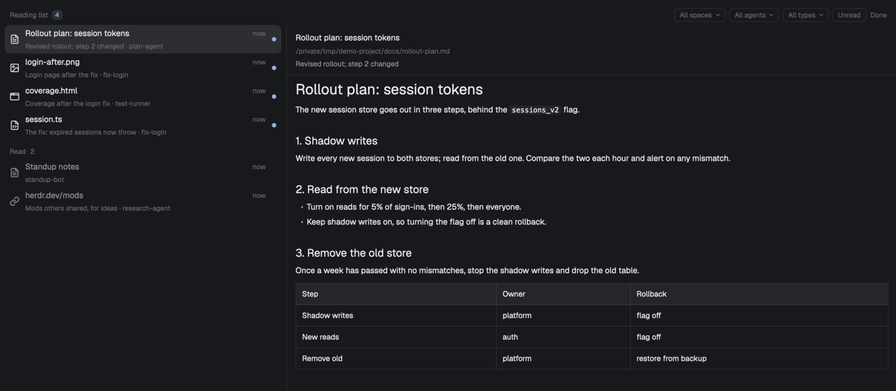

# Reading list

A list of files and links that agents and tools put up for the person to read. An agent runs
`rl add plan.md --note "why"`; the item appears at the top of the list with a toast, showing what
it is, the note and who added it. The person walks the list with the keyboard, sees a preview of
the selected item beside the list (rendered markdown, highlighted code, images, Quick Look
thumbnails of HTML and PDF), opens it in its macOS app with Enter, and marks it done. Agents on
other machines Herdr reaches add to that machine's own list, which shows here too: their files
are previewed in place or fetched into a local copy to open. It lives in a pane, in the left
sidebar, or as a popup on `cmd-shift-i`. macOS only.

## What you see

All colors are `theme()` names, so it follows the person's theme; sizes are logical pixels.

- **Header** (41 high, 16 side padding): "Reading list" in 11.5 medium `dim`, then the unread count
  as a chip (10.5 semibold `accent` text on `accent` at 15% alpha, 16 high, 5 radius). On the right:
  in a pane 520 or wider, four filter chips ("All spaces", "All agents", "All types" each with a
  chevron, and "Unread"; 22 high, 6 radius, 1px `border`, 11 `dim`; a chip that is on gets an
  `accent` border at 40% and `accent` fill at 10%), then a "Done" link (11 `dim`, "Done 3" when
  there are done items, "Back to list" in the Done view). Narrower, one filter icon (14) instead of
  the chips; the filters that are on show as removable chips under the header.
- **Install banner** (only while `rl` can't be run from a terminal): a box under the header (14
  side margin, 8 radius, `raised` fill, 1px `border`, 12 text): "Agents add to this list with rl,
  which is not installed." with an **Install rl** button (24 high, `solid` fill, `solid_foreground`
  medium text) and a "Not now" link. Other states: "The rl on your PATH (…) is another program."
  (with the button), "rl is in ~/.local/bin, which is not on your PATH…" (no button). When `rl`
  is fine here, the same box speaks for the first other machine without it: "rl is not installed
  on devbox, so agents there cannot add to this list." with **Install rl on devbox**.
- **List** (rows 46 high, 8 radius, 8 side padding; group heads 30 high): unread items first,
  newest first, then a "Read  2" head and the read ones. Each row: a 16 type icon (markdown and
  text, code, HTML, image, PDF, folder, link, file), the title (13; unread `foreground` medium,
  read `muted`), the age ("now", "5m", "3h", "2d"; 11 `dim`), an unread dot (7, `accent`), and a
  second line (11 `dim`) "note · who" (the agent's program and terminal, "(ended)" when it has
  gone, or the `--from` name). A "changed" chip (`accent`) on a read item whose file changed since;
  "×3" when added three times; "gone · …" when the file has moved. Another machine's item has a
  chip with the machine's name (`muted`), an "offline" chip (`blocked`) while that machine does not
  answer, and "copy from devbox, fetched 18:42" at the end of its second line once a copy was
  fetched. The selected row is `selected` (`raised` when the list has no keyboard); hover is `hover`.
- **Preview**: in a pane 520 or wider it fills the right of the list (the list takes 42% of the
  width, 300 to 460), separated by a 1px `border`, on `background`. A header (14 side padding, 1px `border` under it) with the title (medium), the
  path or URL (11 `dim`; `devbox:/path` for another machine's, with "on devbox" or "copy from devbox,
  fetched 18:42; edits to the copy stay on this Mac" under it) and the note (11.5 `muted`), then
  the body: markdown rendered (`TextView.markdown`),
  text and code in a read-only editor with highlighting, images, a Quick Look thumbnail for HTML,
  PDF and anything else Quick Look draws, a folder's entries, a link's URL, "gone" for a missing
  file. Narrower, the preview is hidden until `p`, then shows below the list (half the pane, at
  most 260).
- **Key hints** (24 high, 10.5 `dim`) at the bottom while the list has the keyboard: "↵ open  ␣ look
  p preview  v viewer  o reveal  c copy  / find  f filter  r read  d done  tab done", and "R
  refresh" when other machines are connected.
- **Backgrounds**: `background` in a pane, `chrome` with a top `border` in the sidebar, `popover`
  in the popup. Under 160 wide (a collapsed sidebar) it becomes a rail: a bookmark icon with the
  unread count, and one icon per item.
- **Empty**: "Nothing to read. Agents add files with rl add <path> --note "why", or drop files
  here." (12 `dim`).

## How it behaves

- **Arrival**: the mod watches the list folder (`watchFolder`), so an `rl add` shows at once. New
  items post one toast ("Reading list: plan.md" with "who: note", or "3 new on your reading list"
  for a burst within 2.5 s); `--kind fyi` items and files the person dropped don't toast. Only one
  copy of the mod toasts each arrival. Clicking the toast focuses a reading-list pane, else opens
  the popup.
- **Keys** (while the list has the keyboard; a click on it gives it the keyboard): click or
  `j`/`k`/arrows/`g`/`G`/Home/End select (selecting never opens); Enter or a double-click opens in
  the default app and marks read (the popup then closes); Space toggles the macOS Quick Look panel
  (doesn't mark read); `p` preview in the pane; `v` opens a preview-only pane on the right of the
  window that follows the selection of any copy (`v` again closes it); `o` reveals in Finder; `c`
  copies the path or URL (with a toast); `r` read/unread; `d` done (Tab switches to the Done view,
  where `d` or `u` brings it back); Shift-D deletes the item file (no undo); `/` opens a filter box
  (title, note, path; Enter or Down back to the list, Esc clears); `f` opens the filter menu (a
  250-wide popup with sections Space, Agent, Type and Show (All items / Unread only), each option with its count, a check on the chosen one; `j`/`k`, Enter); Shift-R lists
  this machine and every other one again now. Each is also a command,
  `readlist.<down|up|top|bottom|open|preview|pane|reveal|copy|read|done|undo|delete|view|find|filter|viewer|focus|install-rl|refresh>`,
  which only the copy that had the keyboard last acts on (else the sidebar's).
- **Opening**: files open with `open`; executable items (`.app`, scripts, `.command`, anything with
  an execute bit, installers) are revealed in Finder instead, with a toast saying why. Links open in
  the browser.
- **Re-adding** the same path makes it unread and moves it to the top; `adds` counts.
- **Drop folder**: anything put in the list folder's `inbox/`, or dropped onto the list, is added
  (from "inbox" or "dropped"); the file stays where it is.
- **Install rl**: the button (or `readlist.install-rl`) copies the mod's `bin/rl` to
  `~/.local/bin/rl` and toasts the result: installed, updated an older copy, already this version,
  `~/.local/bin` not on PATH, another `rl` first on PATH, or "another program called rl; left as it
  is". It never overwrites another program or a link. "Not now" hides the banner in that copy until
  the state changes. The status is checked on start and every 30 s.
- **Times** refresh every 30 s, when files are also re-checked for the "changed" chip.
- **Other machines** (each named machine in `machines()` whose layout is ready): listed every 15 s
  while a copy of the mod is alive, and on Shift-R, with one `exec(..., {on})` per machine that
  prints the list folder there (`$READING_LIST_DIR` or `~/.local/state/reading-list/` in that
  machine's environment), whether `rl` is there, a stat line for each file of the last listing,
  and every item file after a record-separator line, ending with an "end" record. Nothing is
  written there. Their items are keyed `<machine>/<id>` in `state.json`. Text and markdown
  previews are read there (`readTextFile(path, {on})`, up to 1 MiB, else `head` there); folders are
  listed there. For an image, thumbnail, Enter, Space or `o` the file is fetched into
  `.cache/remote/<machine>/<id>/copy/<its name>` (with a `meta` of its mtime, size and fetch
  time) and everything runs on the copy; it is fetched again when the file's mtime or size
  changes there. Up to 5 MiB it comes as base64 through `exec` and is decoded here; larger, in
  7 MiB chunks through `hc exec --on` (whose output stops at 8 MB), else with `scp`; the size is
  checked either way. Over 50 MiB, Enter (or Space, `o`) says the size and fetches on a second
  press within 15 s; the preview says so instead of fetching. A machine that stops answering keeps
  its items, marked offline, until it answers again; state for its items is not pruned meanwhile.
  A machine without `sh` (Windows) has no list and is not polled again until it reconnects.
  Shift-D removes the item file on its machine. **Install rl on devbox** sends the mod's `rl` as
  an argument and installs it to `~/.local/bin` there, with the same rules as here.

## Built from

- `mods/readlist/` (the mod, `NAME` in `core/name.js`): `main.js` is one `View` for every role,
  chosen by props: none (a pane), `{role: "sidebar"}` (a layout block), the popup
  (`mod.json` `{"place": "none", "focusable": true, "overlay": {"width": 560, "height": 480}}`,
  opened by `mod.open:readlist`), `{role: "viewer"}` (the `v` pane), `{menu, target}` (a filter
  menu). `core/*.js` are pure functions and shell scripts, node-tested: `items.js` (parse, types,
  open action), `state.js` (read/done state), `filters.js`, `arrival.js` (toast claims),
  `inbox.js`, `preview.js`, `viewer.js`, `install.js`, `remote.js` (the poll, each machine's
  online/offline state, local copies). `icons/` are Lucide SVGs (ISC).
- `mods/readlist/bin/rl`: the producer, POSIX `sh` and `awk`. Writes `items/<id>.json` atomically
  (temp file, `mv`); id = first 16 hex of SHA-256 of the real path or URL; fills `by` from
  `hc get $HC_TERMINAL_ID --json` inside a Herdr terminal.
- The list folder: `$READING_LIST_DIR` or `~/.local/state/reading-list/`: `items/`, `inbox/`,
  `state.json` (per item `read_at`, `done_at`, `undone_at`, `seen_mtime`, and the inbox entries added, written only by the mod with
  `writeTextFile`'s compare-and-swap).
- `herdr`: `exec` (`sh -c` scripts with arguments, `open`, `qlmanage -p` and `-t`; with `on` for
  other machines), `hc` (`machine ls`, for `scp`'s target), `machines`, `readTextFile`,
  `writeTextFile`, `watchFolder`, `nextCommand`, `agents`, `spaces`, `panes`, `focused`, `theme`,
  `settings`, `layout`, `props`, `notify` (with an `action`), `appHome`, `run` (`pane.split`,
  `pane.close`, `pane.focus`), `shared`/`setShared` (`readlist.toasted`, `.quiet`, `.unread`,
  `.selected`, `.viewer`, `.pick`, `.keyboard`), `openOverlay`/`closeOverlay`, `localStorage`.
  `gpui-base`: `v_virtual_list`, `Scrollbar`, `TextView.markdown`, `EditorState`/`Editor`,
  `InputState`/`Input`.
- `keys.json`: `"global": {"cmd-shift-i": "mod.open:readlist"}`.
- Programs it runs: `sh`, `open`, `qlmanage`, `stat`, `head`, `ls`, `cp`, `mv`, `rm`, `ps`/`kill`
  (only the Quick Look panel or thumbnail it started), `base64`, `hc`, `scp` and `shasum` (through
  `rl`); on other machines, through Herdr, `sh`, `cat`, `stat`, `head`, `ls`, `base64`, `dd`, `rm`
  and `cp`/`mv` (installing `rl`). No network beyond Herdr's own connections and `scp`.

## Watch out

- `image()` loads only from the app home: images and thumbnails are copied into the mod's hidden
  `.cache/` (one file per item and file version; hidden, so writing there doesn't reload the mod),
  and pruned when items go.
- `qlmanage -p` must run in the background (`& echo $!`) or `exec`'s 30 s limit kills the panel;
  closing it kills only that pid, and only while it is still `qlmanage`.
- Every shown copy gets every `readlist.<command>`; without the "keyboard owner" in shared state,
  `j` would move every copy at once. Commands reach shown copies only.
- Several copies see the same arrival: claim in shared state and toast only what is still yours
  after the burst, or the person gets two toasts.
- Install the mod as a copy, not a symlink (a symlinked mod neither hot-reloads nor writes).
- The `rl` in the mod may lose its execute bit when copied by a tool: the mod runs it with `sh`.
- A copy installed under another folder name must change `core/name.js` and the `readlist` in
  `keys.json` and in commands.
- macOS only (`open`, `qlmanage`, `open -R`). Text previews read the first 512 KiB; folders show
  200 entries.
- `stat -f` on Linux prints file-system data and succeeds: try GNU `stat -c` first, BSD `stat -f`
  after.
- `exec` keeps 8 MiB of output and `hc exec` 8 MB: base64 only up to 5 MiB, chunks above that,
  and check the size of every copy.
- `qlmanage -t` never returns for a file Quick Look has no thumbnail for: stop it after 20 s (by
  its pid), or the preview waits for `exec`'s timeout.
- A poll whose output lacks the final "end" record (cut short) is not a listing: keep the items.
- The review hand-off (`R`) is not built; nothing shows for it.

## Done when

- `herdr-app check ~/.config/herdr-app/mods/readlist` passes.
- `rl add <a markdown file> --note hi` in a Herdr terminal shows the item at the top of an open
  list within a second, with a toast "Reading list: <title>" naming the agent, and the unread chip
  goes up by one.
- In a pane wider than 520 the selected markdown item is rendered beside the list; `j` moves the
  selection and the preview follows; Enter opens the file in its app and the item moves under
  "Read".
- `d` moves it to the Done view (Tab), and `d` there brings it back; `rl ls --done` agrees.
- `cmd-shift-i` opens the popup; Esc closes it.
- With no `rl` on PATH the banner shows; Install rl puts `~/.local/bin/rl` in place (mode 755) and
  says so; with a different file already at `~/.local/bin/rl` it leaves it and says so.
- A file copied into `~/.local/state/reading-list/inbox/` appears as an item from "inbox".
