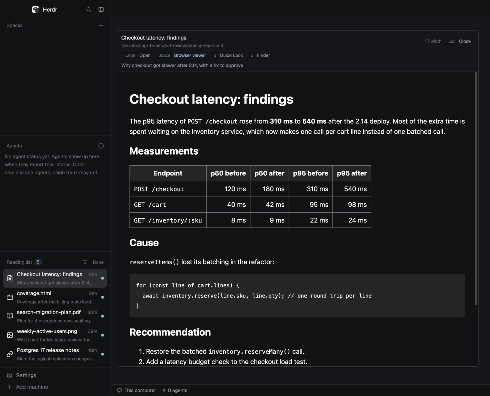

# Reading list

A list of files and links that agents and tools put up for the person to read. An agent runs
`rl add plan.md --note "why"`; the item appears at the top of the list with a toast, showing what
it is, the note and who added it. The person walks the list with the keyboard, previews an item
with Space in a window inside Herdr (Markdown, HTML and PDF drawn as page tiles, images, a frame of
a video, a still of a glTF model, highlighted code, else a Quick Look thumbnail; from there Enter
opens it, Space opens the interactive viewer in the browser, `q` the platform's preview window),
or docks that preview beside the sidebar with `v`, opens it in its default app with Enter, browses
a folder item's contents in the list, and marks it done. Agents on
other machines Herdr reaches add to that machine's own list, which shows here too: their files
are read there for the preview or fetched into a local copy. When the person turns it on, files
Claude Code agents send them with their SendUserFile tool arrive on the list too, without the agent
running `rl`. It lives in a pane, in the left sidebar, or as a popup on `cmd-shift-i`
(`ctrl-shift-i` on Linux and Windows).
`skill/reading-list/SKILL.md` is an agent skill that teaches agents when and how to add.

| Platform | Support |
|---|---|
| macOS | Full: `open`, Finder (`open -R`), the Quick Look panel and thumbnails (`qlmanage`). |
| Linux | Supported: `xdg-open`, the file manager through the freedesktop `FileManager1` D-Bus call (`gdbus`), else `xdg-open` on the folder; the platform preview window is GNOME Sushi when installed; no thumbnails (other types show their icon). |
| Windows | Supported, with PowerShell 7 (`pwsh`): the default app (the shell's association), Explorer (`explorer /select,`), the platform preview window is the QuickLook app or PowerToys Peek when installed; images are drawn, other types show their icon. `rl` is `rl.ps1` (with `rl.cmd` and a Git Bash shim); the list lives in `%LOCALAPPDATA%\reading-list`. |

On all three, Space opens the built-in preview window inside Herdr, unless the person chose
"System preview" in the `f` menu (then the platform's preview window, or the built-in one where
there is none). Page tiles and the browser viewer need Node.js 20 or newer and a browser; without
them the window shows the text. On macOS, closing the browser viewer or the Quick Look panel
while it is the active app makes Herdr active again.

Each action (open, reveal, the Space preview window, thumbnails) is a handler, a program run with
the item as a separate argument: one built in per platform, and in front of it, only once the
person turns it on, their own `~/.config/herdr-app/readlist/handler` (`handler.ps1` on Windows).

## What you see

All colors are `theme()` names, so it follows the person's theme; sizes are logical pixels.

- **Header** (41 high, 16 side padding): "Reading list" in 11.5 medium `dim`, then the unread count
  as a chip (10.5 semibold `accent` text on `accent` at 15% alpha, 16 high, 5 radius). On the right:
  in a pane 520 or wider, four filter chips ("All spaces", "All agents", "All types" each with a
  chevron, and "Unread"; 22 high, 6 radius, 1px `border`, 11 `dim`; a chip that is on gets an
  `accent` border at 40% and `accent` fill at 10%), then a "Done" link (11 `dim`, "Done 3" when
  there are done items, "Back to list" in the Done view). Narrower, one filter icon (14) instead of
  the chips; the filters that are on show as removable chips under the header.
- **Install banner** (only while `rl` can't be run from a terminal): a box under the header (14
  side margin, 8 radius, `raised` fill, 1px `border`, 12 text): "Agents add to this list with rl,
  which is not installed." with an **Install rl** button (24 high, `solid` fill, `solid_foreground`
  medium text) and a "Not now" link. Other states: "The rl on your PATH (…) is another program."
  (with the button), "rl is in ~/.local/bin, which is not on your PATH…" (no button). On Windows
  each text ends "Install rl copies it to ~\.local\bin and adds that folder to your PATH.", and the
  off-PATH state has the button too (it adds the folder to PATH). When `rl`
  is fine here, the same box speaks for the first other machine without it: "rl is not installed
  on devbox, so agents there cannot add to this list." with **Install rl on devbox**.
- **List** (rows 46 high, 8 radius, 8 side padding; group heads 30 high): unread items first,
  newest first, then a "Read  2" head and the read ones. Each row: a 16 type icon (markdown and
  text, code, HTML, image, PDF, folder, link, file; video and 3D models use the file icon), the title (13; unread `foreground` medium,
  read `muted`), the age ("now", "5m", "3h", "2d"; 11 `dim`), an unread dot (7, `accent`), and a
  second line (11 `dim`) "note · who" (the agent's program and terminal, "(ended)" when it has
  gone, or the `--from` name). A "changed" chip (`accent`) on a read item whose file changed since;
  "×3" when added three times; "gone · …" when the file has moved. Another machine's item has a
  chip with the machine's name (`muted`), an "offline" chip (`blocked`) while that machine does not
  answer, and "copy from devbox, fetched 18:42" at the end of its second line once a copy was
  fetched. The selected row is `selected` (`raised` when the list has no keyboard); hover is `hover`.
- **No preview in the list**: the list is only the list; the built-in preview (below) shows the
  selected item in a window (Space), docked (`v`) or in an `rl preview` pane. Its body: markdown,
  local HTML and PDF as page tiles drawn by a headless browser (see "Page tiles" below), another
  machine's markdown and HTML as text (`TextView.markdown` / `TextView.html`, the `<body>` without
  comments, `<head>`, scripts, styles, inline SVG and the like), text and code in a read-only
  editor with highlighting, images with Fit, zoom buttons and arrow-key pan on their stage, a
  frame of a local video (FFmpeg) else its thumbnail, a poster of a local glTF model, a Quick Look
  thumbnail for anything else Quick Look draws (on Linux and Windows, where there are no
  thumbnails: the type's icon, 48 `muted`, centered, over "No preview for this type here. Enter
  opens it in its app; q shows it in a preview window if one is installed." in 12 `dim`), "gone"
  for a missing file. Its header (12 side padding, 1px `border` under it, `chrome` at 40%) has
  the title (medium), the path or URL (10.5 `dim`; `devbox:/path` for another machine's, with "on
  devbox" or "copy from devbox, fetched 18:42; edits to the copy stay on this Mac" under it), "[ ]
  width" when it can resize, **Esc Close** in the window, and a row of buttons, each a key chip
  and a label: **Enter Open**, **Space Browser viewer** (types the browser viewer shows), **q Quick
  Look** ("Preview window" on Linux and Windows), **o Finder** (the file manager's name).
- **Key hints** (24 high, 10.5 `dim`) at the bottom while the list has the keyboard: "↵ open  ␣ preview
  v dock  o reveal  c copy  / find  f filter  r read  d done  tab done", and "R refresh" when other
  machines are connected. While browsing a folder: "↵ open/browse  ← up  ␣ preview  / find  f filter
  r read  d done".
- **Backgrounds**: `background` in a pane, `chrome` with a top `border` in the sidebar, `popover`
  in the popup. Under 160 wide (a collapsed sidebar) it becomes a rail: a bookmark icon with the
  unread count, and one icon per item.
- **Empty**: "Nothing to read. Agents add files with rl add <path> --note "why", or drop files
  here." (12 `dim`).

## How it behaves

- **Arrival**: the mod watches the list folder (`watchFolder`), so an `rl add` shows at once. New
  items post one toast ("Reading list: plan.md" with "who: note", or "3 new on your reading list"
  for a burst within 2.5 s); `--kind fyi` items and files the person dropped don't toast. Only one
  copy of the mod toasts each arrival. Clicking the toast focuses a reading-list pane, else opens
  the popup.
- **Keys** (while the list has the keyboard; a click on it gives it the keyboard): click or
  `j`/`k`/arrows/`g`/`G`/Home/End select (selecting never opens); Enter or a double-click opens in
  the default app and marks read (the popup then closes), and on a folder item browses it in the
  list (see "Folders"); Space opens the built-in preview window (see "Preview window"; Space
  again on that item closes it), or once the person chose "System preview" toggles the macOS
  Quick Look panel (brought to the front as the active app), on Linux GNOME Sushi (doesn't mark
  read; without Sushi, the built-in window, with a one-time toast saying Sushi is missing); `v`
  shows the built-in preview docked right of the sidebar, following the selection of any copy
  (`v` again hides it); `o` reveals in Finder (the
  file manager on Linux); `c`
  copies the path or URL (with a toast); `r` read/unread; `d` done (Tab switches to the Done view,
  where `d` or `u` brings it back); Shift-D deletes the item file (no undo); `/` opens a filter box
  (title, note, path; Enter or Down back to the list, Esc clears); `f` opens the filter menu (a
  250-wide popup with sections Space, Agent, Type and Show (All items / Unread only), each option with its count, a check on the chosen one, and in the list view a last section "Also add" with
  one entry, "Files Claude Code sends", checked while that source is on, then "Actions" with "Built-in"
  and "Your handler", the one in use checked, then "Space preview" with "Built-in viewer" and
  "System preview", the one in use checked; `j`/`k`, Enter; the popup and its root element both get
  the height of its rows, at most 440 high, then it scrolls
  and `j`/`k` keep the choice and its section's title on screen; a click on a chip opens it at
  the pointer, `f` under the header's right end, or in the middle of the window until the
  pointer has been over that copy); Shift-R lists
  this machine and every other one again now. Each is also a command,
  `readlist.<down|up|top|bottom|open|preview|reveal|copy|read|done|undo|delete|view|find|filter|viewer|focus|install-rl|refresh|claude-files|handler>`,
  which only the copy that had the keyboard last acts on (else the sidebar's).
- **Scrolling in the preview** (`core/scroll.js`): `TextView` and `Editor` cannot be scrolled from
  code, so the built-in preview lays page tiles, and another machine's markdown and HTML, out at
  full height in a clipped box and moves them up by an offset it keeps. Text and code show in a
  read-only highlighted `Editor`, which scrolls itself under the wheel and the trackpad; the
  scroll keys do not move it. The wheel and the trackpad move the rest (`on_scroll_wheel`), and
  while the preview has the keyboard `j`/`k` and Down/Up a line (40), Shift-Space and Page
  Down/Page Up a page less a line, Ctrl-D/Ctrl-U half a page,
  `g`/Home and Shift-G/End the ends; text drawn as rows stops on a whole row at the top, except
  at the end. A 6-wide thumb (`muted` at 40%, rounded 3, 3 from the right,
  at least 24 high) shows where it is when the text is longer than the box; a click on its track
  pages toward the click. Another item starts at the top; Esc on a search puts markdown and HTML
  at the same share of the way down as the search was, and text and code back in the highlighted
  editor at the top.
- **Search in the preview** (while the preview window, the docked preview or the `rl preview`
  pane has the keyboard; a click on it gives it the keyboard): `/` opens a search bar under the
  preview's header (26 high, a search icon, the prompt
  "Find in this item: Enter, then n / Shift-N", an x). Enter goes to the first match after the
  current one (from the top when there is none; an empty prompt repeats the search) and the body
  turns into the item's text drawn row by row in the code font (12, 18-high rows, long lines
  wrapped; markdown as its source, HTML as its text) with every match on `selection` and the current one on `accent`
  in `accent_foreground`, scrolled to the middle with a whole row at the top; the bar says "3 of 12" (11 `dim`), "no matches"
  (`blocked`) or "3 of 12 · wrapped". `n`/Shift-N go to the next/previous match, wrapping; Esc closes
  the search and the preview draws as before. Literal text, case-insensitive unless the query has
  an uppercase letter. Images, thumbnails, folders and links show "Nothing to search in this
  preview." in the bar. The search ends when the selection moves to another item, and follows the
  item's text when its file changes. The list's `/` filter and its other keys are unchanged.
- **Opening**: files open with `open` (Linux: `xdg-open`); executable items (`.app`, scripts,
  `.command`, anything with an execute bit, installers, and on Linux `.desktop`, `.AppImage`, `.run`,
  `.deb`, `.rpm`, `.snap`, `.flatpak`...) are revealed in Finder or the file manager instead, with a
  toast saying why. Links open in the browser. A missing program (`xdg-open`, `gdbus`) gets an
  error toast naming it.
- **Space preview setting**: the `f` menu's "Space preview" writes
  `"readlist": {"space_preview": "builtin" | "system"}` into Herdr's live `settings.json`
  (`appHome()/settings.json`) with `writeTextFile`'s compare-and-swap, keeping every other
  setting, and toasts the new choice. Absent or unreadable is `builtin`. Every Space press reads
  the file again, so the choice (or an edit by hand) applies at once and to every copy. It only
  switches the types the built-in viewer covers; the person's own handler is still asked first.
- **Preview window** (`docs/design.md` 4.8): Space on a file opens the mod itself as an overlay
  window (`openOverlay({kind: "window", key: "readlist-preview", width, height: 0.85, props:
  {role: "window", id, mtime, file, title, source}})`, `width` 70% of
  Herdr's width from `appHome()/window.json` within 640-1280 px, or the width last chosen with
  `[` / `]`, kept in `shared("readlist.window-width")`; a remote item's
  fetched copy as `file`). It draws Markdown, HTML and PDF as tiles with `viewer/render.mjs`
  ("Page tiles" below; a PDF through the host's trusted `pages` view, its first 100 pages, canvases drawn
  only around the tile being captured), a local video's frame with `viewer/video-poster.mjs`
  (FFmpeg, PNG cached by real path, size and mtime under `appHome()/readlist-poster-cache`) and
  the rest as described under "No preview in the list". It focuses itself: Enter opens the file
  as the list's Enter does (revealing what could run) and writes the read mark into
  `state.json` itself (compare-and-swap; the lists see it through their folder watch), Space runs
  the built-in viewer on the file and closes the window, `q` the platform's preview window
  through the handlers (`q` again closes it), `o` reveals, Esc closes, the wheel and the viewer
  pane's scroll keys scroll it, `/` searches its text, Backspace returns from a followed local
  link, `]` / `[` (and `=` / `-` unless it shows an image) open it again 15% wider or narrower
  in its place, scrolled to the same share. Only its title bar drags it. The docked preview (a
  hidden layout block `readlist-viewer` the install adds right after the sidebar, props `{role:
  "viewer"}`, shown and hidden by `layout.toggle` (`v`), hidden by Esc and its header's **Esc Hide**
  button (`layout.hide`), resized by `layout.resize`; `v` reads the
  shown layout's file to find it, since `layout()` leaves hidden nodes out, and splits a pane on
  the right without it) and the `rl preview` pane have the same body and keys, the docked one
  opening and revealing through the list's own `open` and `reveal`. Images sit on a checkerboard (shipped 512 px tiles
  drawn at 256 px, dark or light by the theme) or plain dark or light gray, cycled by `b` and
  kept in `shared("readlist.image-bg")`, inside a thin border at the image's own rectangle: its
  pixel size comes from the first 64 KiB of the cached copy (a `head64` helper prints them as
  base64; `core/image.js` reads PNG, GIF, JPEG, WebP and BMP headers).
  `shared("readlist.window")` (`{overlay, id, copy}`) lets the list toggle it (Space again on
  its item), show another item in it, or close it before another kind of preview; when it
  closes it records whether it had the keyboard, and the list that opened it takes it back.
  The window follows the selection like the docked preview: whenever a list copy's selection
  moves while it is open (a click, the list's keys, a done or delete moving it), that copy
  opens the window again under its key with the new item (its own note under the header, the
  props marked `focus: false` while the list has the keyboard, so the list keeps it), without
  asking the person's handler. A link, a folder or a missing file shows a one-line notice
  instead of the page; a file over 50 MiB on another machine that has no fresh copy shows
  "… not fetched yet. Space in the list fetches a copy." (`held`, so Space then fetches
  rather than closing), and a smaller one is fetched quietly. The latest move wins. In the
  window and the docked preview Shift-J / Shift-K run `readlist.down` / `readlist.up`, which
  the list that had the keyboard last acts on. A click on the list focuses it and leaves the
  window open (a `window` overlay does not close on a click beside it).
- **Built-in viewer** (`viewer/`, see `docs/viewer-contract.md`): Space in the built-in preview
  runs
  `node viewer/host.mjs open <appHome()/readlist/viewer> <absolute file>`. That starts (or
  reuses) a detached `host.mjs serve` process: an HTTP server on `127.0.0.1` only, a random port,
  a random 256-bit token as the first path part, port, token, pid and build hash in a user-only
  `session.json`. A host whose build hash differs from the installed files is stopped (after
  checking its pid's command) and replaced. It opens one browser surface (a Chrome app window on
  macOS, Edge on Windows, Chromium on Linux when installed, else the default browser) and reuses
  it for later items, except on macOS with Chrome, where every open launches a new app window in
  front (`raise`) and the older page closes itself once the host says a newer page spoke. On
  macOS the launcher records the active app's pid before launching (`returnTo`); when the viewer
  page says goodbye and none says hello within 600 ms, the host activates that app if Chrome is
  still the active one (`osascript -l JavaScript`, `NSRunningApplication`, no Apple Events). The shell page shows Markdown (rendered by the bundled Marked, raw HTML as
  text) and HTML in a sandboxed, scriptless frame that can load only the local files the document
  refers to below its own folder (at most 256 files, 64 MiB, 16 MiB each); PDF with the bundled
  PDF.js (pages, zoom, search, copy; no PDF scripts); video with the browser's controls and byte
  ranges; images with fit, actual size, zoom, pan and rotate; `.glb`/`.gltf` with the bundled
  Three.js (orbit, pan, zoom, reset). Nothing comes from a CDN. When `node` or the browser fails,
  the built-in preview says why under its header. Another machine's item uses its fetched
  copy.
- **Page tiles**: for a local Markdown, HTML or PDF item the built-in preview runs
  `node viewer/render.mjs` with the file, the cache folder, the preview's width, scale 2 and light or dark (from `theme().background`). It
  serves the page through the same host rules to a headless Chrome, Chromium or Edge with scripts
  and network off, and saves 512-high PNG tiles, the ones on screen first, updating a progress
  file after each; the mod polls it and shows tiles as they finish, with placeholders for the
  rest. The preview's wheel and scroll keys move the page; a click on a link to another local HTML
  page shows that page, a fragment link scrolls, and **Back**, Backspace or Alt-Left returns. A
  width change (debounced 150 ms) or a theme change draws again. Without a browser, Node or
  WebSocket support a one-line note says which is missing, over the text rendering. A local glTF
  model gets one poster the same way (`viewer/render-model.mjs`).
- **Folders**: Enter on a folder item replaces the list's rows with that folder's entries (an
  "Up" row first, folders before files, at most 200, hidden names only after **Show hidden** or
  `.`). Enter or Right on a subfolder goes in, Left, Backspace or the Up row goes up and at the
  root returns to the list. An entry behaves as an item (preview, Space, Enter, `o`, `c`, `r`, `d`,
  the filters, Tab for done entries), with the folder item's agent and note. Browsing never leaves
  the item's folder, never follows a symlink (each step is checked by a script before use), and
  stops 12 levels down. Another machine's folder is listed there; only a file that is previewed or
  opened is fetched.
- **`rl preview [--pane|--browser] -- PATH`**: shows one existing local file without adding it.
  `--pane` (the default) runs `herdr-app do pane.split` with
  `{"direction":"right","mod":"readlist","props":{"role":"preview","file":"<absolute path>"}}`;
  that copy draws the file as the built-in preview, with the file's name, the preview's buttons
  (Enter, Space for the browser viewer when it covers the type, `q`, `o`) and **Esc Close**. A second call hands its file to
  the pane already open and closes its own. `--browser` runs `viewer/host.mjs open` directly.
  URLs, folders and `--on` are refused; exit 0 handed over, 1 unavailable or refused, 2 syntax.
- **Re-adding** the same path makes it unread and moves it to the top; `adds` counts.
- **Drop folder**: anything put in the list folder's `inbox/`, or dropped onto the list, is added
  (from "inbox" or "dropped"); the file stays where it is.
- **Files Claude Code sends** (off until turned on with the `f` menu's "Files Claude Code sends" or
  `readlist.claude-files`, which toggles it and toasts the new setting): for each Claude Code agent
  on this computer in `agents()`, `hc get <t> --json` gives the terminal's foreground pid; Claude Code's
  `sessions/<pid>.json` (in `$CLAUDE_CONFIG_DIR` or `~/.claude`; the pid's children and
  grandchildren are tried too) gives the session id, and `projects/*/<session id>.jsonl` is the
  transcript. One `sh` script reads every transcript's lines containing `file_uuid` (skipping
  lines over 256 KiB, and skipping a transcript whose size and mtime are unchanged since this
  copy last read it); the mod keeps the tool results whose `toolUseResult.attachments` list
  delivered files. Each delivered file is added with the mod's `rl add --if-new --kind result`,
  the send's caption as the note, the agent's terminal looked up as for an agent running `rl`, and
  "Claude Code t7" as the `--from` fallback. Only sends made since the setting was turned on are
  added, and each once: `state.json`'s `claude_files` keeps, per session, the time of the latest
  send handled, and a file already on the list (added with `rl`, or sent before) is left as it is.
  A file that is gone, a missing or malformed session file or transcript, or an agent without a
  session is skipped quietly. It reads transcripts when a Claude Code agent comes, goes or changes
  state and every 30 s, while a copy of the list is shown; sends of a session that ended while no
  copy was shown are not added. Agents on other machines are not read.
- **Handlers**: every action runs `sh mods/readlist/bin/run-handler` with separate arguments,
  which runs the handler as `ACTION [ARG...] -- ITEM` (ITEM an absolute path with its folders
  resolved, or an http(s) link for `open-url`; nothing else from the item): `open`, `reveal`,
  `open-url`, `preview` (prints a token), `preview-close TOKEN same|other`, `thumbnail SIZE OUT`.
  Exit 0 done, 10 not handled (the next handler, then the mod's fallback: the browser, the
  built-in preview window, the type's icon), else an error whose first stderr line is toasted. 15 s per action,
  30 s per thumbnail, one try each; a thumbnail that failed or that no handler made is not asked
  for again until the file or the handlers change. The built-in ones are `handlers/macos.sh`
  (`open`, `open -R`, `qlmanage -p` with its pid as the token, brought to the front by `osascript`,
  and `kill` of that pid only while it is `qlmanage`, `qlmanage -t`) and `handlers/linux.sh`
  (`xdg-open`, the FileManager1 call, GNOME Sushi, not handled only with no `gdbus`, no session bus
  or no Sushi service; `other` keeps Sushi's window; no thumbnails), picked by `window().platform`.
  The person's own `~/.config/herdr-app/readlist/handler` is tried first only after they turn it
  on (the `f` menu's Actions, `readlist.handler`); that records its real path and SHA-256 in
  `~/.config/herdr-app/readlist/trust.json`. `run-handler` checks it before every run and exits 11
  ("readlist: why") instead when it changed, now leads elsewhere, is not a regular executable file
  owned by the person, is writable by group or others, or is below a folder (or a link's folder)
  another user owns or group or others can write; the built-in handler then acts, a toast says why
  once, and a banner under the header (styled like the rl banner) gives the path with **Use it**
  (confirm the file as it is now, for changed or moved) and "Turn off". While it is on and used, the
  key hints end with "your handler" (`accent`, right-aligned).
  On Windows the runner is `bin/windows/run-handler.ps1` (pwsh), the built-in handler
  `handlers/windows.ps1` (`Process.Start` with the shell's association, `explorer.exe
  /select,"PATH"`, `QuickLook.exe PATH` or `PowerToys.Peek.UI.exe PATH` with the token `quicklook`
  or `peek`, QuickLook run again on `same` to close it; open refuses the types that could run and
  any type in `PATHEXT`; `READLIST_DRY_RUN=1` prints `would: ...` instead), and the person's handler
  is `readlist\handler.ps1`, run in a pwsh of its own and stopped with everything it started after
  12 s (28 s for a thumbnail). It is refused unless it is a `.ps1` file owned by the person (or
  Administrators, or SYSTEM) that no other account (Everyone, Users, Authenticated Users, any user
  or group but the person, SYSTEM, Administrators, TrustedInstaller) may write, append to, delete,
  re-permission or take; its folder must not let others add, delete or rename entries, and no
  folder above it (or above a link or junction on the way) may let others write into it, delete
  from it or change it (creating new folders, which Windows lets every user do at a drive's root,
  is fine).
- **Install rl**: the button (or `readlist.install-rl`) copies the mod's `bin/rl` to
  `~/.local/bin/rl` and toasts the result: installed, updated an older copy, already this version,
  `~/.local/bin` not on PATH, another `rl` first on PATH, or "another program called rl; left as it
  is". It never overwrites another program or a link. "Not now" hides the banner in that copy until
  the state changes. The status is checked on start and every 30 s. On Windows it copies `rl.ps1`,
  `rl.cmd` and `rl` (the Git Bash shim) from `bin/windows` to `~\.local\bin` and, when that folder
  is not on PATH, appends `%USERPROFILE%\.local\bin` to the person's own PATH (HKCU\Environment,
  the other entries kept unexpanded) and tells running programs; the toast says programs started
  before then find `rl` after a restart. The status reads PATH afresh from the registry.
- **Times** refresh every 30 s, when files are also re-checked for the "changed" chip.
- **Other machines** (each named machine in `machines()` whose layout is ready): listed every 15 s
  while a copy of the mod is alive, and on Shift-R, with one `exec(..., {on})` per machine that
  prints the list folder there (`$READING_LIST_DIR` or `~/.local/state/reading-list/` in that
  machine's environment), whether `rl` is there, a stat line for each file of the last listing,
  and every item file after a record-separator line, ending with an "end" record. Nothing is
  written there. Their items are keyed `<machine>/<id>` in `state.json`. Text and markdown
  previews are read there (`readTextFile(path, {on})`, up to 1 MiB, else `head` there); folders are
  listed there. For an image, thumbnail, Enter, Space or `o` the file is fetched into
  `.cache/remote/<machine>/<id>/copy/<its name>` (with a `meta` of its mtime, size and fetch
  time) and everything runs on the copy; it is fetched again when the file's mtime or size
  changes there. Up to 5 MiB it comes as base64 through `exec` and is decoded here; larger, in
  7 MiB chunks through `hc exec --on` (whose output stops at 8 MB), else with `scp`; the size is
  checked either way. Over 50 MiB, Enter (or Space, `o`) says the size and fetches on a second
  press within 15 s; the preview says so instead of fetching. A machine that stops answering keeps
  its items, marked offline, until it answers again; state for its items is not pruned meanwhile.
  Another machine without `sh` (Windows, as another machine) has no list here and is not polled
  again until it reconnects.
  Shift-D removes the item file on its machine. **Install rl on devbox** sends the mod's `rl` as
  an argument and installs it to `~/.local/bin` there, with the same rules as here.

## Built from

- `mods/readlist/` (the mod, `NAME` in `core/name.js`): `main.js` is one `View` for every role,
  chosen by props: none (a pane), `{role: "sidebar"}` (a layout block), the popup
  (`mod.json` `{"place": "none", "focusable": true, "overlay": {"width": 560, "height": 480}}`,
  opened by `mod.open:readlist`), `{role: "viewer"}` (the docked preview `v` shows), `{role: "preview", file}` (the pane `rl preview` opens),
  `{menu, target}` (a filter menu). `core/*.js` are pure functions and shell scripts, node-tested: `items.js` (parse, types,
  open action), `state.js` (read/done state), `filters.js`, `arrival.js` (toast claims),
  `inbox.js`, `preview.js`, `viewer.js`, `search.js` (search in the viewer: matches, smart case,
  next/previous, rows), `scroll.js` (scrolling in the viewer: keys, wheel, thumb), `install.js`, `remote.js` (the poll, each machine's
  online/offline state, local copies), `sent.js` (files Claude Code agents sent: the transcript
  scan, the record of what was added), `browser-viewer.js` (which types Space sends to the
  built-in viewer), `preview-setting.js` (the Space preview choice in `settings.json`),
  `folder.js` (folder browsing: path rules, the listing and safety scripts), `tiles.js` (HTML
  tiles: capture order, the tiles on screen, links and Back). `icons/` are Lucide SVGs (ISC).
- `mods/readlist/viewer/` (Node.js 20 or newer, not loaded by the mod itself): `host.mjs` (the
  loopback server, the launcher and the allowed-file manifest), `shell.html`, `shell.css`,
  `shell.js`, `image-controls.js`, `gltf-view.js` (the page shown in the browser), `markdown.mjs`
  (Marked with raw HTML escaped and links confined), `render.mjs` and `tile-cache.mjs` (HTML
  tiles, a least-recently-used cache of at most 256 MiB), `render-model.mjs` (model posters), and
  the bundled `marked/` (18.2.0, MIT), `pdfjs/` (pdfjs-dist 4.10.38, Apache-2.0) and `three/`
  (0.187.0, MIT), each with its LICENSE; `VENDORED.md` lists their sources and checksums.
- `mods/readlist/bin/rl`: the producer, POSIX `sh` and `awk`. Writes `items/<id>.json` atomically
  (temp file, `mv`); id = first 16 hex of SHA-256 of the real path or URL; fills `by` from
  `hc get $HC_TERMINAL_ID --json` inside a Herdr terminal. `--if-new` leaves an item already on the
  list as it is. `rl preview` writes nothing: it resolves the file (the last link too) and hands
  it to a pane or to the built-in viewer.
- `mods/readlist/bin/windows/`: Windows (PowerShell 7). `rl.ps1` is the same producer (same
  commands, item JSON byte for byte, id rule; the real path has the drive letter upper case, each
  name as on disk and links and junctions resolved, e.g. `C:\Users\me\plan.md`; default list folder
  `%LOCALAPPDATA%\reading-list`), `rl.cmd` runs it from cmd.exe and other programs, `rl` from Git
  Bash. `readlist.ps1` is one script whose operations stand for the `sh` scripts in `core/*.js`
  (`core/helpers.js` maps each; same arguments and output shapes). `run-handler.ps1` checks and
  runs handlers; `common.ps1` is shared by the last two.
- `skill/reading-list/SKILL.md`: the agent skill (frontmatter `name` and `description`): when to
  add (deliverables, reports, results, decisions; not routine progress), the kinds, a useful note,
  `--from`, and the no-install JSON fallback.
- The list folder: `$READING_LIST_DIR` or `~/.local/state/reading-list/`: `items/`, `inbox/`,
  `state.json` (per item `read_at`, `done_at`, `undone_at`, `seen_mtime`, the inbox entries added,
  and `claude_files`: `on`, `since` and per session the latest send handled; written only by the
  mod with `writeTextFile`'s compare-and-swap).
- `mods/readlist/handlers/`: the built-in action handlers, `macos.sh` and `linux.sh` (POSIX `sh`);
  `mods/readlist/bin/run-handler`: checks the person's handler and runs any handler with the item
  as one argument; `core/handlers.js`: the interface, the order handlers are tried in, the
  opt-in record.
- `herdr`: `exec` (`sh -c` scripts and `sh` files with arguments, on Windows `pwsh -File` with
  arguments, with a `timeout`; with `on` for
  other machines), `window` (`platform`: `macos`, `linux` or `windows`; `core/handlers.js` picks
  the built-in handler from it), `hc` (`machine ls`, for `scp`'s target), `machines`, `readTextFile`,
  `writeTextFile`, `watchFolder`, `nextCommand`, `agents`, `spaces`, `panes`, `focused`, `theme`,
  `settings`, `layout`, `props`, `notify` (with an `action`), `appHome`, `run` (`pane.split`,
  `pane.close`, `pane.focus`), `shared`/`setShared` (`readlist.toasted`, `.quiet`, `.unread`,
  `.selected`, `.viewer`, `.preview-pane`, `.pick`, `.keyboard`, `.handler`), `openOverlay`/`closeOverlay`, `localStorage`.
  `gpui-base`: `v_virtual_list`, `Scrollbar`, `TextView.markdown`/`TextView.html`, `EditorState`/`Editor`,
  `InputState`/`Input`.
- `keys.json`: `"global": {"cmd-shift-i": "mod.open:readlist", "ctrl-shift-i": "mod.open:readlist"}`.
  Merge only your platform's: `cmd-shift-i` on macOS, `ctrl-shift-i` on Linux and Windows (free in
  Herdr's shipped keys there).
- Programs it runs: `sh`, `open`, `qlmanage`, `osascript` (macOS), `xdg-open`, `gdbus` (Linux, both optional), `stat`, `head`, `ls`, `cp`, `mv`, `rm`, `ps`/`kill`, `pgrep`, `grep`, `awk`, `sed`
  (only the Quick Look panel or thumbnail it started), `base64`, `hc`, `scp` and `shasum` (through
  `rl`), `id`, `find`, `readlink`, `sha256sum` or `shasum`, `od` (handlers), and the person's own
  handler once they turn it on; for the built-in viewer and page tiles, when installed, `node`,
  a browser (Chrome, Chromium or Edge, headless for tiles and model posters) and `ffmpeg` (a
  video's poster); on other machines, through Herdr, `sh`, `cat`, `stat`, `head`, `ls`, `base64`, `dd`, `rm`
  and `cp`/`mv` (installing `rl`). On Windows, here: `pwsh` (its scripts in `bin/windows` and
  `handlers/windows.ps1`), `explorer.exe`, `QuickLook.exe` or `PowerToys.Peek.UI.exe` when
  installed, `hc`, `scp`, and the person's handler once they turn it on. No network beyond Herdr's
  own connections, `scp`, and the built-in viewer's server on `127.0.0.1`.

## Watch out

- `image()` loads only from the app home: images and thumbnails are copied into the mod's hidden
  `.cache/` (one file per item and file version; hidden, so writing there doesn't reload the mod),
  and pruned when items go.
- Headless-browser screenshots (page tiles, model stills) go under `appHome()`, in
  `readlist-tile-cache/` and `readlist-model-cache/`, not under `mods/`: Herdr watches that tree
  and would reload the mod on every tile. `image()` still loads them, since they are in the app
  home.
- The built-in viewer shows files nobody vetted: bind `127.0.0.1` only, require the session token
  on every route, reject other Host headers, serve only files in the selected document's manifest
  (real paths below its real folder, no escaping symlinks), and load the document in
  `<iframe sandbox="">` with a CSP that allows no scripts and no network.
- Never follow a symlink while browsing a folder, and check every path a listing produced against
  the item's root before using it: names come from the folder, not from the person.
- `qlmanage -p` must run in the background (`& echo $!`) or `exec`'s 30 s limit kills the panel;
  closing it kills only that pid, and only while it is still `qlmanage`.
- `qlmanage -p` does not activate itself, so its panel opens behind Herdr. The handler activates
  it once its window is on screen: `osascript -l JavaScript` with
  `NSRunningApplication.activateWithOptions` on its pid, in the background. That sends no Apple
  Events, so there is no Automation or Accessibility prompt (telling System Events to set the
  process frontmost would ask for Automation consent). Handing the focus back to Herdr puts
  Herdr's window over the panel again, so the panel stays the active app until it closes. macOS
  honours the activation only while Herdr is the frontmost app, which it is when Space is pressed.
  The same script then waits for the panel to close; if it was the active app until then, it
  activates the app Space was pressed in, or macOS fronts some other app's window. It asks
  `NSWorkspace.frontmostApplication`, which stays current only while the script runs its run loop
  (`NSRunLoop.runUntilDate`, not `delay`); the window order is no guide, since with several
  displays the panel stays the top window of its own display while another app is active.
- Every shown copy gets every `readlist.<command>`; without the "keyboard owner" in shared state,
  `j` would move every copy at once. Commands reach shown copies only.
- Several copies see the same arrival: claim in shared state and toast only what is still yours
  after the burst, or the person gets two toasts.
- Install the mod as a copy, not a symlink (a symlinked mod neither hot-reloads nor writes).
- The `rl` in the mod may lose its execute bit when copied by a tool: the mod runs it with `sh`.
- A copy installed under another folder name must change `core/name.js` and the `readlist` in
  `keys.json` and in commands.
- A handler is run with argv, the item last after `--`; never put item data in a shell string. A
  handler's own `exit 10` means "not handled", so a built-in handler maps a program's status 10 to
  1. Kill a background program by its pid and `wait "$pid" 2>/dev/null` (also for a killed
  watchdog), or the shell's "Terminated" notice becomes the first line of the error.
- The person's handler is trusted only as confirmed: check ownership, permissions, every folder
  above it and the hash right before each run, in the same `sh` that then `exec`s it. Test
  folders under Linux's `/tmp` fail those checks (it is world-writable), as they should.
- Pick commands by `window().platform`, and keep each Linux program optional: check with
  `command -v` and print what to install. Text previews read the first 512 KiB; folders show
  200 entries.
- Windows has no `sh`: every helper there is an operation of `bin/windows/readlist.ps1`, run as
  `pwsh -NoProfile -NonInteractive -ExecutionPolicy Bypass -File SCRIPT OP ARG...`, never
  `-Command` (which joins its arguments into code). `pwsh -File` splits an argument like `-x:1` in
  `$args`, so the scripts read their arguments from `[Environment]::GetCommandLineArgs()` after
  `-File <script>`; a handler's arguments before `--` never start with `-`. Inside PowerShell, a
  literal `--` in a command is the end-of-parameters marker and vanishes: pass it in a splatted
  array. Write stdout as UTF-8 bytes with LF (the console's code page is not UTF-8), and give rl's
  item files LF too. A file name cannot hold `:` (it names an alternate data stream): paths with
  one are refused. Temporary folders may be 8.3 short names (`RUNNER~1`): resolve names with Win32
  matching. Files an elevated program makes are owned by Administrators.
- `xdg-open` may keep running as long as the app it started: run it in the background with its
  output in a file, wait up to 3 s for its exit status, and return; else `exec`'s 30 s limit kills
  the app with it.
- D-Bus arguments for `gdbus call` are GVariant text: pass `['file:///...']` and `'file:///...'`
  with every byte of the path that is not unreserved percent-encoded (a `'` included), so a path
  can never break out of the literal. `FileManager1.ShowItems` takes `(as, s)`; Sushi's
  `NautilusPreviewer2.ShowFile` takes `(s uri, s window handle, b close if shown)`, the older
  `NautilusPreviewer.ShowFile` `(s, i, b)`. An uninstalled service fails at once with
  `ServiceUnknown`.
- `stat -f` on Linux prints file-system data and succeeds: try GNU `stat -c` first, BSD `stat -f`
  after.
- `exec` keeps 8 MiB of output and `hc exec` 8 MB: base64 only up to 5 MiB, chunks above that,
  and check the size of every copy.
- `qlmanage -t` never returns for a file Quick Look has no thumbnail for: stop it after 20 s (by
  its pid), or the preview waits for `exec`'s timeout.
- A poll whose output lacks the final "end" record (cut short) is not a listing: keep the items.
- The review hand-off (`R`) is not built; nothing shows for it.
- Claude Code transcripts grow to tens of MB and `readTextFile` stops at 1 MiB: read them with
  `grep` in a script, never in the mod. A transcript also holds lines that merely mention
  `file_uuid` (a file the agent read, a command's output): only a `user` line whose
  `toolUseResult.attachments` carry a `file_uuid` is a delivered send.
- Writing `state.json` lists the folder again (it is watched): the transcript scan writes only when
  it added something, saw a new session, or a session's record is a day old.

## Done when

- `herdr-app check ~/.config/herdr-app/mods/readlist` passes.
- `rl add <a markdown file> --note hi` in a Herdr terminal shows the item at the top of an open
  list within a second, with a toast "Reading list: <title>" naming the agent, and the unread chip
  goes up by one.
- The list shows no preview of its own; Enter opens the selected file in its app and the item
  moves under "Read".
- Space on a local Markdown file opens a floating Herdr window showing the rendered page; `j` in
  the list (after a click on it) or Shift-J in the window shows the next item in the same window,
  and Space again on the selected item closes it. Esc closes it
  and the list has the keyboard again. `v` shows the same preview docked right of the sidebar,
  following `j`/`k`; `v` again or its **Hide** button hides it.
- In the preview, Enter opens the file and marks it read; Space opens one browser window on
  `http://127.0.0.1:<port>/<token>/shell` showing it (a later Space reuses or replaces it); `q`
  opens Quick Look; `o` reveals it; `]` / `[` change its width and the next open keeps it. On
  macOS, closing that browser window or Quick Look while it is the active app makes Herdr active
  again. With `"readlist": {"space_preview": "system"}` (the `f` menu's "System preview") Space
  in the list opens the platform's preview window instead, without restarting anything. With no
  `node` on PATH, the built-in preview shows the text and Space there says the viewer could not
  open.
- A local HTML item with a stylesheet shows in the built-in preview as the styled page (tiles), not
  as bare text, when Chrome, Chromium or Edge is installed; an image shows on a checkerboard
  inside a thin border.
- Enter on a folder item lists its entries in place; Right enters a subfolder, Left goes back, and
  a symlink inside it is not listed.
- `rl preview -- <file>` opens a preview pane on the right without adding an item; a second call
  shows the new file in the same pane; `rl preview -- https://example.com` exits 1.
- `d` moves it to the Done view (Tab), and `d` there brings it back; `rl ls --done` agrees.
- `cmd-shift-i` (`ctrl-shift-i` on Linux and Windows) opens the popup; Esc closes it.
- With no `rl` on PATH the banner shows; Install rl puts `~/.local/bin/rl` in place (mode 755) and
  says so; with a different file already at `~/.local/bin/rl` it leaves it and says so.
- A file copied into `~/.local/state/reading-list/inbox/` appears as an item from "inbox".
- With no handler turned on, Enter, Space and `o` do what the platform table says. A handler at
  `~/.config/herdr-app/readlist/handler` that opens `.md` files and exits 10 otherwise, turned on
  from the `f` menu, opens a markdown item its way and anything else as before; editing the handler
  shows the banner and the built-in action runs until **Use it**; `chmod g+w` on it is refused (on
  Windows: `readlist\handler.ps1`; `icacls handler.ps1 /grant *S-1-5-32-545:(W)` is refused).
- On Windows: `rl add`, `rl ls`, `rl done`, `rl rm` work from PowerShell, cmd.exe and Git Bash,
  and an item file made on macOS lists and is marked done unchanged but for `done_at`; Enter opens
  a PDF in its default app, `o` selects it in Explorer, Enter on a `.exe`, `.ps1` or `.lnk` selects
  it in Explorer instead; with "System preview", Space opens QuickLook or Peek when installed, else the built-in preview.
- With "Files Claude Code sends" off, a Claude Code agent's SendUserFile adds nothing. Turned on, a
  file the agent sends next appears as a `result` item with the caption as its note, naming that
  agent; sending a file that is already on the list leaves its item as it is.
